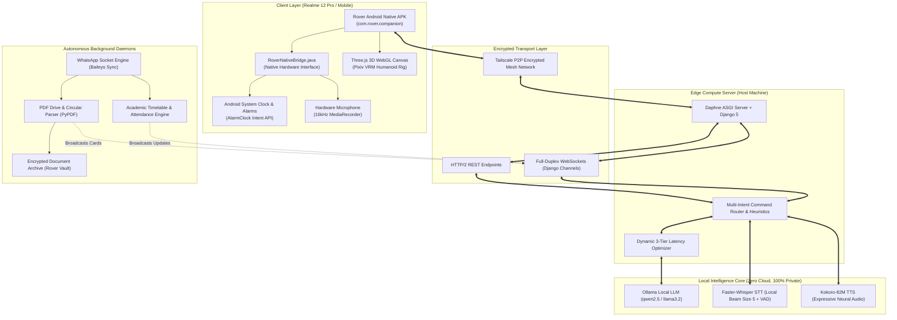

# Rover — Autonomous Personal AI Companion & Academic Co-Pilot

[](https://python.org)
[](https://developer.android.com)
[](https://ollama.ai)
[](https://github.com/SYSTRAN/faster-whisper)
[](https://github.com/hexgrad/kokoro)
[](https://www.djangoproject.com)
[](https://threejs.org)
[](https://tailscale.com)

> **Rover** is a 100% offline, privacy-first personal AI companion and autonomous academic co-pilot. Built from the ground up to eliminate reliance on proprietary cloud services, Rover combines edge-computed natural language processing, real-time voice conversations, 3D interactive avatar embodiment (Shorekeeper), automated college intelligence, and cross-device Android system integration over a secure mesh network.

---

## 📌 Architectural Overview



---

## 🌟 Key Engineering Highlights

### 1. 🎙️ 100% Offline, Real-Time Voice Pipeline (0% Cloud, 0% Google)
* **Local Speech-to-Text (STT):** Powered by `faster-whisper` running locally with beam size 5, Silero VAD (Voice Activity Detection), and domain-specific acoustic hotwords for college coursework and placement terminology.
* **Neural Text-to-Speech (TTS):** Generates expressive speech via the lightweight `Kokoro-82M` neural voice model, producing high-fidelity audio with natural inflection.
* **Dynamic 3-Tier Latency Optimization:**
  * **Tier 1 (Instant Banter / Identity):** Cap at 16 tokens (`temp = 0.30`) for **1.08s total voice response latency**.
  * **Tier 2 (Conversational Chat):** Cap at 22 tokens (`temp = 0.35`) for natural conversational dialogue under ~1.8s.
  * **Tier 3 (Technical & Academic Explanations):** 42 tokens (`temp = 0.45`) with sentence boundary truncation prevention (`_clean_dangling_tail`).
* **Frame-Perfect Lip Sync:** Solved asynchronous network streaming latency by synchronizing mouth morph targets strictly with the browser's audio buffer playback (`roverAudio.onplay`), guaranteeing zero visual lag.

### 2. 📱 Custom Android Hybrid App & Native OS Hardware Bridge
* **Engineered a Native Android APK (`RoverNativeBridge.java`):**
  * Solved Chromium WebView's security sandbox restrictions where `navigator.mediaDevices.getUserMedia` is blocked over insecure network origins.
  * Injected native Java interfaces capturing audio directly via Android's `MediaRecorder` at **16 kHz AAC**, feeding raw Base64 payloads directly to laptop Whisper via HTTP POST.
* **OS-Level System Clock Programming:**
  * Uses `AlarmClock.ACTION_SET_ALARM` to program physical wake-up alarms directly into Google Clock / Samsung Clock without opening the app UI.
  * Features emergency high-priority sirens that bypass Android's "Do Not Disturb" and Silent mode using `AudioManager.STREAM_ALARM` with custom vibration wave patterns.

### 3. 🪐 Interactive 3D Humanoid Avatar (Shorekeeper / Pixiv VRM)
* **Humanoid Kinematics & Rig Remapping:**
  * Built on Three.js and Pixiv VRM with bone remapping for Mixamo animation rigs (sitting, relaxed idle, walking, stretching, turning, waving).
  * Implemented an autonomous roaming state machine that dynamically calculates 5–7 exploration waypoints with lookaround and stretch pauses.
* **Resumable 1.5MB Chunked Streaming:**
  * Delivers heavy 21.5MB 3D avatar assets across Tailscale mesh connections using HTTP Range byte requests (`206 Partial Content`) paired with client-side IndexedDB caching.

### 4. 🎓 Autonomous Academic Intelligence & WhatsApp Automation
* **Real-Time Group Announcement Parsing:**
  * Runs headless background daemons monitoring official college WhatsApp communication channels via WebSocket sockets.
  * **Automated Timetable & Alarm Synchronization:** Detects lecture cancellations and room changes for specific division/batch filters (e.g. Division C4). If an 8:00 AM lecture is cancelled, Rover automatically recalculates sleep schedules and shifts morning alarms.
  * **Drive Postponement & Cancellation Engine:** Contextually differentiates between new recruitment drives and postponement circulars (e.g., detecting date shifts like *"postponed until after Diwali"*), deduplicating records across companies.
* **Document Vault & 1-Tap PDF Streaming:**
  * Automatically archives placement circulars and Job Descriptions (JDs) into a secure document vault (`Rover_Vault/Placements/`).
  * Injects direct streaming endpoints (`/api/college/document/`) enabling 1-tap PDF inspection directly within the companion chat HUD.
* **Natural Hinglish Family Notifications:**
  * Integrates natural language translation to relay arrival notes to family via WhatsApp in polite 3rd-person Hinglish (*"woh shaam ko 6 baje tak ghar pahunch jayega"*).

---

## 🛠️ Technology Stack

| Domain | Technologies Used |
| :--- | :--- |
| **Edge Backend** | Python 3.11, Django 5.0, Django Channels (ASGI), Daphne, SQLite3 |
| **Mobile Architecture** | Android SDK (Java 17), Android WebView, Gradle 8.7, AndroidX |
| **Local Machine Learning** | Ollama, Qwen 2.5, Faster-Whisper (CTranslate2), Kokoro-82M (PyTorch) |
| **Frontend & Graphics** | Three.js (WebGL), Pixiv Three-VRM, Vanilla ES6 JavaScript, HTML5/CSS3 |
| **Networking & Protocols** | Full-Duplex WebSockets, HTTP/2, Tailscale Encrypted WireGuard Mesh |
| **Automation & Extraction** | PyPDF, Baileys WebSocket Sync (Node.js), Windows Sleep Prevention API |

---

## 📱 Mobile Companion Interface Preview

```
┌────────────────────────────────────────────────────────┐
│  🪐 Rover v1.3   [● Online]    [🎙️ Mic On]   [🪐 3D]   │
├────────────────────────────────────────────────────────┤
│                                                        │
│           [ 3D Interactive VRM Avatar Stage ]          │
│                  (Shorekeeper Model)                   │
│                                                        │
│   [🌌 Sitting]  [🪑 Sit]  [🚶 Walk]  [🔄 Turn]  [👋 Wave]   │
├────────────────────────────────────────────────────────┤
│ 🗓️ INTERVIEW SCHEDULE                        16:31  ✕  │
│ Webosphere Tech                                        │
│ (Reverse Bits & Mechanism Drive)                       │
│                                                        │
│ 💼 Role: Trainee / Intern Slots                        │
│ 📍 Venue: 1102 A – The Capital, Science City Road      │
│ ⏰ Deadline: Check Notice                              │
│                                                        │
│ [📄 View Original PDF]       [🔊 Listen to Summary]    │
├────────────────────────────────────────────────────────┤
│ [📅 Timetable]     [⏰ Alarms]     [🌡️ Laptop Temp]     │
│ ┌────────────────────────────────────────────────────┐ │
│ │ Message Rover...                       🎙️  ✈️      │ │
│ └────────────────────────────────────────────────────┘ │
└────────────────────────────────────────────────────────┘
```

---

## 🔒 Code Availability & Architecture Disclaimer

> **Notice:** The core system automation daemons, credential management pipelines, and private WhatsApp integration layers are maintained in a secure private repository to safeguard local network credentials and personal automation infrastructure.
> 
> *Technical deep-dives, live architecture demonstrations, and component walkthroughs are available upon request during interviews.*

---

## 👤 Author

**Pathan Faiyaazkhan**  
*Computer Engineering Student & AI Systems Developer*  
- **GitHub:** [@FaiyaazKhan](https://github.com/FaiyaazKhan)  
- **Focus Areas:** Autonomous Agentic AI, Edge Computing, Computer Vision & Graphics, Full-Stack Distributed Systems.

